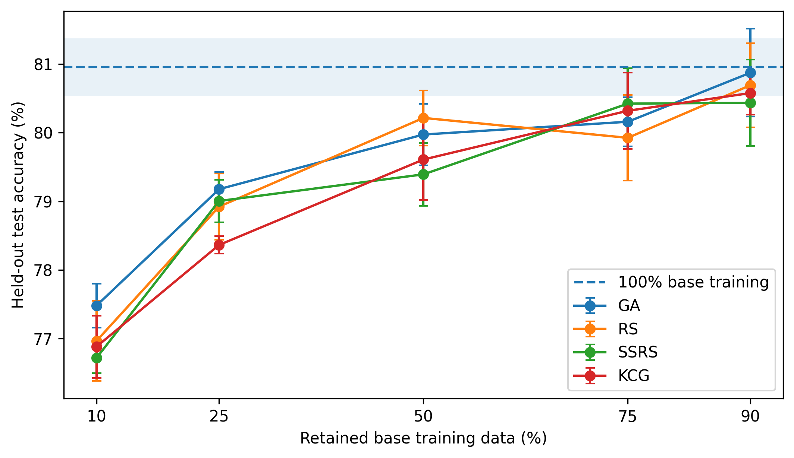
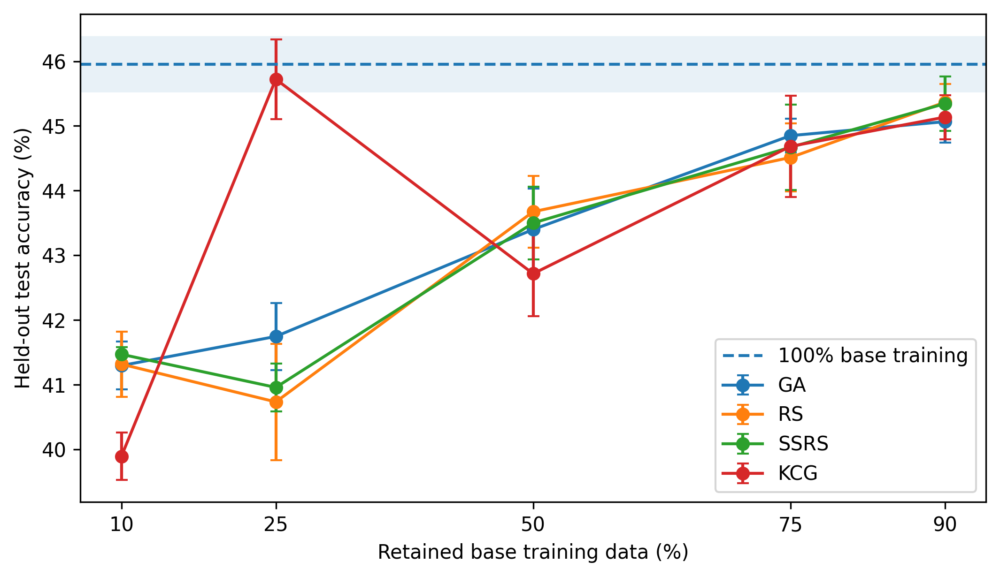

# Metaheuristic-Based Instance Selection for Compact Training of Deep Neural Networks

**Master's Thesis · MSc in Artificial Intelligence Research · Menéndez Pelayo International University (UIMP) · September 2026**  
**Final grade: 9.5/10**

[**Thesis (PDF)**](docs/masters_thesis.pdf) · [**Presentation (PDF)**](docs/thesis_presentation.pdf) · [**Reproducibility notes**](docs/REPRODUCIBILITY.md) · [**Citation**](CITATION.cff)

> **Can we train an accurate image classifier using only a fraction of the available training examples?**
>
> This research investigates fixed-size training-set selection through metaheuristic optimization, using **frozen, ImageNet-pretrained visual representations and newly trained linear classifiers**. It compares the predictive performance and computational costs of more sophisticated subset searches against simpler selection strategies.

**Keywords:** Deep Learning, Image Classification, Training-Data Reduction, Instance Selection, Transfer Learning, Metaheuristics, Evolutionary Computation.

## At a glance

- **Task:** select compact, informative subsets of training examples for image classification.
- **Datasets:** MNIST, CIFAR-10, and Tiny ImageNet.
- **Feature extractors:** AlexNet, ResNeXt-50, EfficientNetV2-S, and Swin-T (pretrained on ImageNet and kept frozen).
- **Search methods:** Random Search (RS), Large Neighborhood Search (LNS), Genetic Algorithm (GA), and Memetic Algorithm (MA).
- **Main-study baselines:** Single Stratified Random Sample (SRS), global k-center greedy (KCG), and training with 100% of the base-training set.
- **Evaluation:** fixed-cardinality subset selection with a separate internal validation split and a held-out test set.

## Key results

| Dataset / stage | Method | Training-data retention | Test accuracy | Full-data reference | Difference |
| --- | --- | ---: | ---: | ---: | ---: |
| CIFAR-10 (main study) | Genetic Algorithm (GA) | 90% | **80.87%** | 80.95% | −0.08 pp |
| Tiny ImageNet (main study) | Global k-center greedy (KCG) | **25%** | **45.72%** | 45.95% | −0.23 pp |

In the preliminary **MNIST** screening, **AlexNet + GA** achieved the highest aggregate validation accuracy (**96.976%**), leading to its descriptive selection for the main study.

The larger search budget also proved relevant: only **10%** of definitive GA/RS runs had already identified their eventual best solution by candidate evaluation 100 (out of 1,000).

**Interpretation:** substantial training-data reduction can preserve competitive classification performance **under the frozen-feature, linear-evaluation protocol studied here**. However, no selection method consistently dominates across datasets and retention levels, and computationally expensive wrapper searches offer only small or inconsistent improvements over simpler baselines. These findings should not be interpreted as results from end-to-end fine-tuning of the feature extractors.

### Main-study visualizations

| CIFAR-10 | Tiny ImageNet |
| --- | --- |
|  |  |

Additional tables and plots are available in [`analysis_outputs/`](analysis_outputs/). The analysis can be regenerated from the archived results without training new models.

## Methodology

### Experimental protocol

The original training partition is split deterministically into **80% base training / 20% internal validation** (split seed: 42). Subsets are selected only from base training. Validation accuracy guides search, whereas held-out test data are used **only after the final subset has been selected**.

ImageNet-pretrained feature extractors remain frozen. Their representations are computed once and cached; each candidate subset trains a **fresh linear classifier** for 10 epochs. This enables controlled comparisons of selection strategies without repeatedly training the entire deep network.

Across the experiments, the evaluated retention levels are **10%, 25%, 50%, 75%, and 90%**, with seeds **42, 123, 456, 789, and 1024**. Full implementation settings and the final-evaluation seed protocol are documented in [`docs/REPRODUCIBILITY.md`](docs/REPRODUCIBILITY.md).

### Stage 1 — Preliminary screening on MNIST

- **Representations:** AlexNet, ResNeXt-50 32×4d, EfficientNetV2-S, and Swin-T.
- **Methods:** RS, LNS, GA, and MA.
- **Design:** 4 representations × 4 methods × 5 retention levels × 5 seeds = **400 searches**.
- **Search budget:** **100 candidate evaluations** per search.
- **Outcome:** AlexNet + GA achieved the strongest aggregate validation result and AlexNet was chosen descriptively as the frozen representation for Stage 2.

### Stage 2 — Main study on CIFAR-10 and Tiny ImageNet

- **Frozen representation:** AlexNet.
- **Guided search:** GA and RS, each with a budget of **1,000 candidate evaluations** (100 searches in total across datasets, methods, retention levels, and seeds).
- **Baselines:** one class-stratified random subset (SRS), global k-center greedy (KCG), and the full base-training set (100%).
- **Assessment:** held-out accuracy, data retention, and computational cost, with results interpreted across the experimental conditions rather than from a single best run.

For the formal analysis, assumptions, and limitations, see the [full thesis](docs/masters_thesis.pdf).

## Repository structure

```text
.
├── algorithms/                       # RS, LNS, GA, MA, SRS, and KCG implementations
├── utils/                            # Data loading, training, configuration, selection
├── notebooks/
│   └── final_results_analysis.ipynb  # Reproduces reported tables and figures
├── scripts/
│   └── slurm/                        # Launch scripts for DaSCI infrastructure
│       └── legacy/                   # Earlier / preliminary launch scripts
├── results/
│   ├── preliminary/mnist/            # MNIST screening experiments
│   ├── main/guided_b1000/            # Definitive GA and RS searches
│   ├── main/srs/                     # Stratified random baseline
│   ├── main/kcg/                     # Global k-center greedy baseline
│   ├── main/full_data/               # 100% training-data reference
│   └── diagnostics/guided_b100/      # Earlier B=100 diagnostics
├── analysis_outputs/                 # Tables and figures from archived experiments
├── data/                             # Dataset layout; large artifacts excluded
├── docs/                             # Reproducibility notes
├── extract_features.py              # Frozen-feature extraction
├── run_experiments.py                # Search experiment runner
├── run_global_kcenter_experiments.py
├── requirements.txt
├── CITATION.cff
├── docs/masters_thesis.pdf                       # Thesis document
└── docs/thesis_presentation.pdf                  # Thesis defense slides
```

The experiment implementation is preserved from the original project; the repository organization separates code, launch scripts, archived results, and analysis artifacts.

## Setup and reproducibility

### Environment

The definitive experiment manifests report:

| Component | Version |
| --- | --- |
| Python | 3.12.13 |
| PyTorch | 2.5.1+cu121 |
| Torchvision | 0.20.1+cu121 |
| NumPy | 2.5.1 |
| scikit-learn | 1.9.0 |

Install the Python dependencies listed in the repository:

```bash
pip install -r requirements.txt
```

For GPU-based experiments, ensure that your PyTorch installation is compatible with your own CUDA driver and hardware. The original experiments were executed on Linux/HPC infrastructure; reproducing them elsewhere may require adapting paths, environments, and hardware settings.

### Data and cached features

**Raw datasets, extracted feature tensors, and KCG pairwise-distance caches are not included in Git** because of their size.

- **MNIST and CIFAR-10:** retrieved by the project's data-loading code when required.
- **Tiny ImageNet:** download separately and extract to `data/tiny-imagenet-200/` using its standard structure.
- **Frozen features:** generate with `extract_features.py` or the extraction Slurm script; outputs are stored in `data/features/<DATASET>/<MODEL>/`.
- **KCG distance cache:** generated separately and reused by the KCG experiments.

Feature and distance caches can require **tens of gigabytes** of storage. See [`data/README.md`](data/README.md) for the exact expected paths.

### Running the experiments

The scripts in [`scripts/slurm/`](scripts/slurm/) document the original DaSCI cluster workflow. **Their hard-coded paths and Conda environment references must be changed before use on another machine.** The following commands illustrate the workflow; they are not a one-command, platform-independent reproduction recipe.

```bash
# 1. Generate frozen image features (example)
sbatch scripts/slurm/extract_features_slurm.sh MNIST alexnet

# 2. Run a preliminary MNIST configuration (example)
sbatch scripts/slurm/run_preliminary_features_slurm.sh alexnet MNIST GEN 10

# 3. Run a main-stage search configuration (example)
sbatch scripts/slurm/run_main_b1000_features_slurm.sh alexnet CIFAR10 GEN 50 42

# 4. Run main-stage reference methods (examples)
sbatch scripts/slurm/run_stratified_random_features_slurm.sh CIFAR10 50
sbatch scripts/slurm/run_global_k_center_greedy_features_slurm.sh CIFAR10
sbatch scripts/slurm/run_full100_zeus_slurm.sh CIFAR10
```

For the complete matrix, seed logic, training setup, deterministic settings, and hardware information, consult [`docs/REPRODUCIBILITY.md`](docs/REPRODUCIBILITY.md).

### Reproducing the figures and tables

Open and execute:

```text
notebooks/final_results_analysis.ipynb
```

The notebook consumes the archived experiment outputs and regenerates CSV summaries and figures in `analysis_outputs/`. **No model retraining is needed to reproduce this analysis.**

## Computational infrastructure

- **Hera (preliminary MNIST stage):** 4 × NVIDIA Titan RTX.
- **Zeus (definitive main study):** 4 × NVIDIA GeForce RTX 2080 Ti.
- Each selection or final-evaluation job used one GPU and four CPU cores.

These computing environments were part of the DaSCI infrastructure, and Stage-2 runtime comparisons were made within the same node family.

## Author and acknowledgements

**Juan Manuel Rodríguez Gómez**  
MSc in Artificial Intelligence Research · Menéndez Pelayo International University (UIMP)

Thesis supervised by **Pablo Mesejo Santiago** and **Óscar Cordón García** (University of Granada).

## Citation and license

If you use or reference this work, please cite the Master's Thesis. A machine-readable citation is available in [`CITATION.cff`](CITATION.cff).

This repository includes a [`CC0-1.0 license`](LICENSE). Please review the terms and attribution requirements of any third-party datasets, pretrained model weights, and other dependencies separately.
